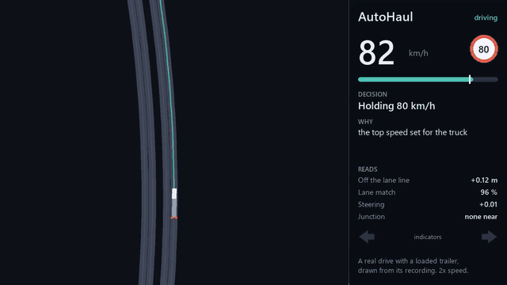
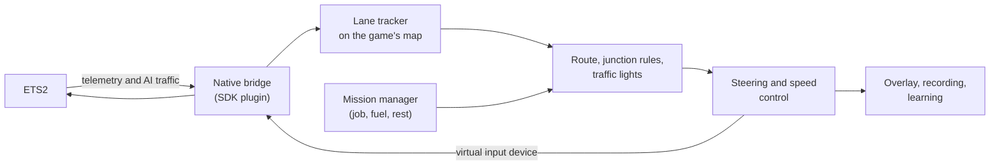

# AutoHaul

**A self-driving truck for Euro Truck Simulator 2, single-player only.** Accept a job or name a place, press a key, and AutoHaul drives: motorways, exits, junctions, traffic lights and tolls, explaining every decision as it goes.



*A real drive at 2x speed: off the motorway at 80 km/h, down the ramp, giving way to two vehicles, then a right turn at a junction with a loaded trailer. This is drawn from the drive's recording, not game footage. The teal line is the route, the amber line is where the truck actually went, and the panel shows what AutoHaul logged at that moment. Other traffic isn't recorded, so it doesn't appear. [Watch the sharper MP4](docs/media/drive.mp4).*

## What it does

- **Drives the road:** keeps its lane, follows speed limits, slows for curves and keeps its distance from traffic.
- **Follows a route:** plans lane by lane across the map, takes exits and interchanges, and changes lanes with the indicator after checking the gap.
- **Handles junctions:** gives way, takes its right of way and stops at stop signs, using the rules in the game's own map data. It reads traffic lights from the screen.
- **Runs the job:** goes to the trailer and on to the destination, and plans fuel and rest stops against deadlines and costs.
- **Looks after the truck:** engine, parking brake, gears, indicators, headlights and wipers.
- **Learns:** adjusts itself to your truck in small, bounded, reversible steps, and learns from how you drive when you take over.
- **Explains itself:** a see-through overlay shows what it reads, what it decided and why.

## How it works



AutoHaul doesn't drive from a camera. It reads the truck's exact position from the game's official telemetry SDK and matches it against a lane map built from the game's files, so it knows which lane it's in and what lies ahead. It reads other vehicles through a read-only memory plugin, and looks at the screen only for the colour of traffic lights.

Steering, pedals and buttons go in through the SDK's virtual input device, the same way a controller would, so your own keyboard or wheel keeps working.

## Status

Everything is tested in a simulator on the real map (246 tests). Real-world proof varies:

| Feature | State |
|---|---|
| Lane keeping, speed, following traffic | Works in the game, over many drives |
| Routes, exits, lane changes | Works in the game |
| Give way, right of way, indicators | Works in the game |
| Traffic lights | Works in the game; it has still run some reds, so watch it in towns |
| Whole job, to a delivered load | Done in the game, using the game's own quick park and auto load |
| Toll gates | Built and driven; plazas are still best done by hand |
| Overlay, launcher, headlights | Works in the game |
| Wipers (from the rain the game saves) | Built; up to 5 minutes late, not yet confirmed in real rain |
| Learning | Built and running; give it time before judging the results |
| Fuel and rest stops | Simulator only; no real trip has needed one yet |
| Reversing to the trailer and coupling | Simulator only |
| Latest tight-turn and give-way fixes | Simulator only; not yet driven |

**Not built:** picking jobs from the freight market (you accept the job), ferries and trains, repair stops, and seeing what the game doesn't report, such as parked trailers and walls in yards.

**This is a driver assistant to supervise, not something to leave running unattended.** When it isn't sure, it slows, stops safely and hands the truck back to you. The open gaps are listed in [docs/AUTONOMY.md](docs/AUTONOMY.md).

## Get started

You need Windows, ETS2 **1.53.2.1** (other versions are untested and the plugins are pinned to this one), Python 3.12, Visual Studio Build Tools with the C++ workload, Node.js (only for extracting the map) and git.

1. Set up the project:

   ```bash
   py -3.12 -m venv .venv
   ```

   ```bash
   .venv/Scripts/python.exe -m pip install -e ".[dev]"
   ```

2. Tell it where your game is, if it isn't in the default Steam location. Create `config/local.toml`, which git ignores:

   ```toml
   [game]
   install_dir = 'D:\Games\Euro Truck Simulator 2'
   home_dir = '%USERPROFILE%\Documents\Euro Truck Simulator 2'
   ```

3. Fetch the pinned dependencies and build the native parts:

   ```bash
   .venv/Scripts/python.exe tools/fetch_deps.py
   ```

   ```bash
   .venv/Scripts/python.exe tools/build_native.py
   ```

4. With the game closed, install the plugins. The second one reads AI traffic, and AutoHaul needs it for junctions and following:

   ```bash
   .venv/Scripts/python.exe tools/install_plugin.py --with-ets2la
   ```

5. Extract the map from your game files:

   ```bash
   .venv/Scripts/python.exe tools/extract_map.py
   ```

6. Check that everything is in place:

   ```bash
   .venv/Scripts/python.exe -m pytest
   ```

## Drive

Double-click **`AutoHaul.bat`**, pick a mode and press **Start**. Then click the game and press `/` to engage.

| Mode | |
|---|---|
| Job (full mission) | Runs the active job: to the trailer, couples it, to the destination, quick park, with fuel and rest stops |
| Drive to a place | Follows the route to a city and, if you choose one, a company there; both boxes suggest as you type |
| Follow the road | Lane keeping and speed, no route |
| Steer only / Speed only | AutoHaul does one, you do the other |

The launcher runs `tools/drive.py` (`--mission`, `--to`, `--no-route`, `--mode`), which also works from a terminal.

### Taking over and stopping

- **Take over:** press `/` or any driving key. AutoHaul holds the lane until you've really got it.
- **Emergency stop:** press `\` or `Pause`, or `Back` + `Start` on an Xbox controller. The plugin itself stops the inputs if AutoHaul goes quiet for 250 ms.
- **Finish:** **Stop** in the launcher hands the truck back and quits.

AutoHaul never supports TruckersMP or Convoy, and refuses to engage if it detects either one.

### Extras in the launcher

- **Show overlay:** a click-through panel on the game showing what AutoHaul reads, what it's doing and why. It never takes focus.
- **Learn while driving:** tunes curve speed, steering, braking and pedals per truck state, inside hard limits. It also slows down where you've had to take over, corrects routes where the game's GPS disagrees, and goes back to earlier values if drives get clearly worse. Every change and its reason is logged; `tools/learn_replay.py --report` shows what it knows, and **Reset learning** forgets it. See [docs/LEARNING.md](docs/LEARNING.md).

While AutoHaul drives, the wipers follow the rain the game records in its autosaves, and the low beam is on from 20:00 to 07:00 game time. If you switch either yourself, AutoHaul leaves it alone for a while.

## Project layout

| Path | |
|---|---|
| `native/` | `autohaul_bridge.dll` (SCS SDK telemetry and virtual input device), fake-game test harness, vendored SDK headers |
| `autohaul/io`, `safety`, `infra` | Shared memory, recorder, kill switch, driver override, multiplayer guard, config |
| `autohaul/world` | Lane map, lane tracker, lane graph, routing, junctions and their rules, place search |
| `autohaul/control` | Steering, speed, lane changes, give way |
| `autohaul/drive` | Autopilot, coupling, indicators, wipers, lights |
| `autohaul/mission` | Jobs, stop planning, economics, refuel and sleep scripts, decision log |
| `autohaul/learn`, `sim` | The learner; truck and game simulators |
| `tools/` | `launcher.py`, `drive.py`, `overlay.py`, simulators (`sim_drive.py`, `sim_mission.py`), `replay.py`, `render_drive.py`, build, install and map tools |
| `config/autohaul.toml` | Every tunable; your overrides go in `config/local.toml` |
| `%USERPROFILE%\AutoHaul\` | Generated data: third-party checkouts, builds, map data, recordings, logs, what it has learned |

## Read more

- [ARCHITECTURE.md](ARCHITECTURE.md): the design
- [docs/PHASE1.md](docs/PHASE1.md): telemetry, control output and the kill switch
- [docs/PHASE2.md](docs/PHASE2.md): lane keeping and speed
- [docs/PHASE3.md](docs/PHASE3.md): routing, junctions, traffic lights, tolls, and fixes from real drives
- [docs/PHASE4.md](docs/PHASE4.md): the mission manager
- [docs/LEARNING.md](docs/LEARNING.md): what it learns and how
- [docs/AUTONOMY.md](docs/AUTONOMY.md): what full autonomy still needs

The clip above is made from a recording with `tools/render_drive.py`.

AutoHaul is an independent project, not affiliated with or endorsed by SCS Software.
